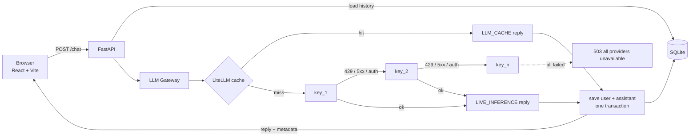

<div align="center">

#  Lyftr AI

### The chatbot that shows you **how** every answer was made.


**API-key failover** · **response caching** · **persistent sessions** · **per-reply telemetry**

[Live URLs](#-live-urls) · [Quick start](#-quick-start) · [How it works](#-how-it-works) · [Deploy](#️-deploy) · [API](#-api) · [Troubleshooting](#-troubleshooting)

</div>

---

## 🎯 What makes it different

Most chatbots hide the plumbing. Lyftr draws it. Every reply carries a **flight recorder**:

| You see | Meaning |
|---|---|
| 🟦 **LIVE_INFERENCE** | Fresh answer generated by the model |
| 🟩 **LLM_CACHE** | Same prompt seen before → served from memory in a few ms |
| 🟨 **Failover** | A key was rate-limited/down, the next key answered silently |
| ⏱ **Latency** | Measured around the provider/cache call |
| 🔢 **Tokens** | Input and output tokens for *that* message only |
| 🗝 **Route** | `you → cache → key_1 ✗ → key_2 → model`, drawn live at the top of the UI |

The sidebar adds **session telemetry** (replies, average latency, cache hits, failovers, tokens) and a **Failover demo** selector so you can break a key on purpose and watch the recovery.

---

## 🌐 Live URLs

| Service | URL |
|---|---|
| Frontend (Vercel) | _add after deploying_ |
| Backend (Render) | _add after deploying_ — try `/health` and `/docs` |

---

## 🚀 Quick start

<details open>
<summary><b>Option A — Docker (one command)</b></summary>

```bash
cp .env.example .env        # put 2+ real keys in LLM_API_KEYS
docker compose up --build -d
```

- Frontend → http://localhost:3000
- Backend → http://localhost:8000/health
- Stop: `docker compose down` · wipe the DB too: `docker compose down -v`
- With `make`: `make up`, `make logs`, `make down`, `make clean`

</details>

<details>
<summary><b>Option B — Without Docker (Python 3.10+, Node 18+)</b></summary>

**Terminal 1 — backend**
```bash
cd backend
python -m venv .venv
source .venv/bin/activate          # Windows: .venv\Scripts\activate
pip install -r requirements-dev.txt
cp ../.env.example .env            # edit keys, set DATABASE_URL=sqlite:///./app.db
uvicorn app.asgi:app --port 8000
```

**Terminal 2 — frontend**
```bash
cd frontend
cp .env.example .env               # VITE_API_URL=http://localhost:8000
npm install
npm run dev                        # http://localhost:3000
```

</details>

> 🔑 Get free Gemini keys at <https://aistudio.google.com/apikey>. Use **two or more** so failover is meaningful.

---

## ⚙️ Configuration

| Variable | Default | Purpose |
|---|---|---|
| `LLM_API_KEYS` | – **(required)** | Comma-separated key pool → `key_1`, `key_2`, … |
| `LLM_MODEL` | `gemini/gemini-3.1-flash-lite` | Any [LiteLLM model string](https://docs.litellm.ai/docs/providers). Providers retire models often; on a 502, change this. |
| `DATABASE_URL` | `sqlite:///./app.db` | SQLite path. `sqlite:////data/app.db` (4 slashes) = absolute, used in Docker/Render |
| `ALLOWED_ORIGINS` | `http://localhost:3000` | Comma-separated CORS origins (exact, no trailing slash) |
| `ENABLE_FAILURE_SIMULATION` | `false` | Enables the `X-Simulate-Failure` demo header |
| `CACHE_TTL_SECONDS` | `86400` | Cache entry lifetime |
| `LLM_TIMEOUT_SECONDS` | `30` | Per-attempt provider timeout |
| `VITE_API_URL` | – | **Frontend, build-time.** Backend URL as seen by the browser |

🔒 Keys live only in backend environment variables. They are never logged, returned, or sent to the browser (a test enforces this). `.env` is gitignored.

---

## 🧠 How it works



<details>
<summary><b>🔁 Key failover</b></summary>

`LLM_API_KEYS=a,b,c` becomes an ordered pool (`key_1…key_3`). For every request the gateway calls `litellm.completion(api_key=…, num_retries=0)` per key, so failover is explicit and fast.

- **Moves to the next key:** 429, quota/resource-exhausted, 5xx, timeouts, connection errors, 401/403 (a bad key is key-specific).
- **Does not retry:** other errors such as 400, which would fail identically on every key → `502`.
- Each failure bumps `fallback_attempts`; the winner is reported as `key_id`.
- All keys fail → `503 {"detail":"all providers unavailable"}`.
- Nothing is permanently disabled; a recovered key is used on the next request.

</details>

<details>
<summary><b>⚡ Caching</b></summary>

LiteLLM's built-in in-memory cache (`Cache(type="local")`). The key is derived from **model + the full message list** (system prompt + history + new message) and **not** from the API key, so an answer produced by `key_1` is still served after `key_1` dies.

- Same first message in two different sessions → **hit**. Different prompt, history or system prompt → **miss**.
- On a hit: `resolution_source=LLM_CACHE`, `key_id=null`, `fallback_attempts=0`.
- Trade-off: per-process and cleared on restart, so run a single instance.

</details>

<details>
<summary><b>🗄 SQLite sessions</b></summary>

One `messages` table: `id, session_id, role, content, metadata, created_at`. A successful turn writes the user row and assistant row (plus a `system` row when a new system prompt is given) in **one transaction**, *after* the LLM succeeded, so failed requests leave no trace. History is read per `session_id` in `id` order. Token counts are per call, never cumulative.

</details>

<details>
<summary><b>🧪 Failure-simulation hook</b></summary>

`X-Simulate-Failure: key_1=429` · `key_1=500` · `key_1=429,key_2=500` · `*=429` (only when `ENABLE_FAILURE_SIMULATION=true`). The named key raises a real LiteLLM error *instead of* calling the provider, for that request only; the next key makes a genuine call. Requests with the header bypass cache reads.

</details>

---

## 🔌 API

| Method | Path | Description |
|---|---|---|
| `GET` | `/health` | `{"status":"ok","keys_configured":2,"cache_enabled":true}` |
| `POST` | `/chat` | Send a message, get `reply` + `metadata` |
| `GET` | `/sessions/{id}/messages` | History, oldest first (404 if unknown) |
| `GET` | `/docs` | Interactive Swagger UI |

```bash
curl -X POST localhost:8000/chat -H 'content-type: application/json' \
  -d '{"session_id":"s-123","message":"What is the capital of France?"}'
```
```json
{
  "session_id": "s-123",
  "reply": "The capital of France is Paris.",
  "metadata": {
    "resolution_source": "LIVE_INFERENCE",
    "model": "gemini/gemini-3.1-flash-lite",
    "latency_ms": 812,
    "input_tokens": 42,
    "output_tokens": 9,
    "key_id": "key_1",
    "fallback_attempts": 0
  }
}
```

Errors are always JSON `{"detail": …}`: `422` validation · `404` unknown session · `502` non-retryable provider error · `503` all providers unavailable · `500` unexpected.

---

## 🧪 Try the features

<details>
<summary><b>Cache hit</b></summary>

In the UI: ask something, click **New chat**, ask the same thing → green `LLM_CACHE` card, a few ms.

```bash
for s in a b; do curl -s -X POST localhost:8000/chat -H 'content-type: application/json' \
  -d "{\"session_id\":\"cache-$s\",\"message\":\"Name three primary colors.\"}" | jq -c .metadata; done
```
</details>

<details>
<summary><b>Failover</b></summary>

In the UI: sidebar → **Failover demo** → pick a scenario → chat.

```bash
# key_1 fails, key_2 answers (fallback_attempts: 1)
curl -s -X POST localhost:8000/chat -H 'content-type: application/json' -H 'X-Simulate-Failure: key_1=429' \
  -d '{"session_id":"fo-1","message":"hello"}' | jq .metadata

# everything fails -> 503, and nothing is stored
curl -si -X POST localhost:8000/chat -H 'content-type: application/json' -H 'X-Simulate-Failure: *=429' \
  -d '{"session_id":"fo-2","message":"hello"}'
```
A real failover also happens if you put an invalid key first in `LLM_API_KEYS`.
</details>

<details>
<summary><b>Per-message token usage</b></summary>

Send two messages in one chat. Turn 2's `in` is larger than turn 1's because it includes history.
</details>

---

## ☁️ Deploy

**Order matters:** GitHub → Render (backend) → Vercel (frontend) → set CORS on Render.

### 1 · Backend → Render

1. **New → Blueprint** and select the repo (uses [`render.yaml`](render.yaml)), or **New → Web Service** with *Runtime: Docker*, *Root directory: `backend`*.
2. Environment variables:

   | Key | Value |
   |---|---|
   | `LLM_API_KEYS` | your keys (secret) |
   | `LLM_MODEL` | `gemini/gemini-3.1-flash-lite` |
   | `DATABASE_URL` | `sqlite:////data/app.db` |
   | `ALLOWED_ORIGINS` | set in step 3 |
   | `ENABLE_FAILURE_SIMULATION` | `true` keeps the demo; `false` for real production |

3. **Persistent disk** mounted at `/data` (≥ 1 GB, needs a paid instance). Without it SQLite is wiped on every restart.
4. Health check path `/health`. Run **one instance** only.

### 2 · Frontend → Vercel

1. **New Project** → import the repo → **Root Directory: `frontend`**.
2. Env var `VITE_API_URL=https://<your-backend>.onrender.com` (Production + Preview).
3. Deploy.

### 3 · Connect them

Set `ALLOWED_ORIGINS=https://<your-app>.vercel.app` on Render (exact origin, no trailing slash) and redeploy the backend.

> `VITE_*` values are baked in at build time. Changing one requires a frontend redeploy.

---

## ✅ Tests

```bash
cd backend && pip install -r requirements-dev.txt && python -m pytest -q     # or: make test
```

38 tests cover health, validation, multi-turn context, session isolation, history order, 404s, cache hit/miss, failover, total failure, the simulation hook, non-persistence of failed requests, per-request tokens, CORS and secret leakage. A **fake LiteLLM custom provider** replaces only the network hop, so the real `litellm.completion`, cache and exception types are exercised. No API keys needed.

---

## 🩺 Troubleshooting

| Symptom | Likely cause → fix |
|---|---|
| `502 upstream provider error` | Model retired or bad request → change `LLM_MODEL` |
| `503 all providers unavailable` | Every key rate-limited or invalid → check keys/quota |
| UI says "Cannot reach the backend" | Wrong `VITE_API_URL`, or a free Render instance is waking up (30–60 s) |
| CORS error in the browser console | `ALLOWED_ORIGINS` doesn't exactly match the frontend origin |
| History gone after redeploy | No persistent disk at `/data` |
| Failover demo does nothing | `ENABLE_FAILURE_SIMULATION` isn't `true` |

---

## 🗂 Project structure

```
backend/
  app/
    config.py     env-driven Settings (no secrets in code)
    db.py         SQLite access, schema created on startup
    gateway.py    key pool, failover loop, LiteLLM cache, failure simulation
    schemas.py    Pydantic request/response models
    main.py       FastAPI app, routes, JSON error handlers, CORS
    asgi.py       `uvicorn app.asgi:app` entrypoint
  tests/          pytest suite (fake provider, no paid calls)
  Dockerfile      multi-stage, non-root, /data volume
frontend/
  src/
    App.jsx       state, send logic, layout, live route bar
    api.js        fetch wrapper, friendly errors
    components/   Sidebar · Message · MetaBadges · RouteTrace · Composer · Welcome
  Dockerfile      node build → nginx :3000
docker-compose.yml · Makefile · render.yaml · .env.example · PROJECT_REPORT.md
```

For a deeper walkthrough see [PROJECT_REPORT.md](PROJECT_REPORT.md).

---

## 🛠 Setup used

- **Editor:** VS Code (Claude Code extension)
- **AI tools:** Claude Code (Claude Sonnet 5.5) for implementation, tests, UI redesign and docs
- **Stack:** FastAPI, LiteLLM 1.110, Pydantic 2, SQLite, React 18, Vite 6, Tailwind CSS 4, lucide-react, pytest, Docker/Compose

---

## 🎁 Extras

Failover demo selector · key-id and failover badges · live route bar · session telemetry · backend connection indicator · honest error UX (failed turn removed and text restored) · cache warm-up at startup · atomic persistence · persistent system prompt per session · copy-reply button · starter prompts · mobile drawer layout.
